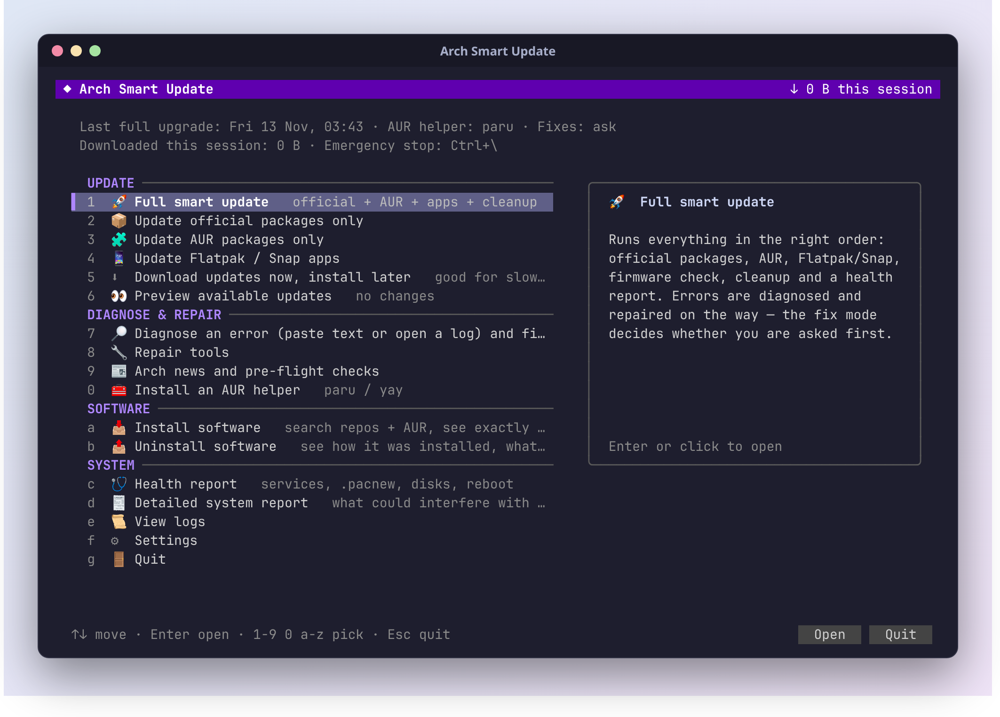
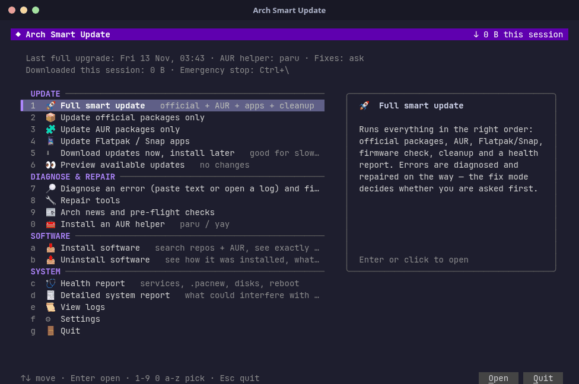
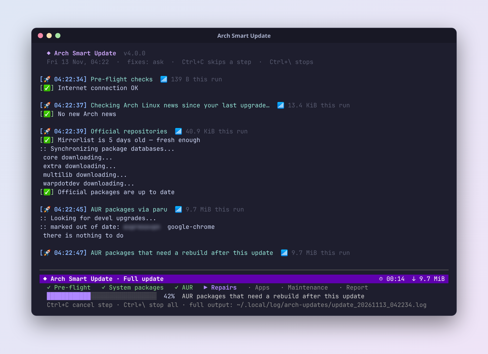
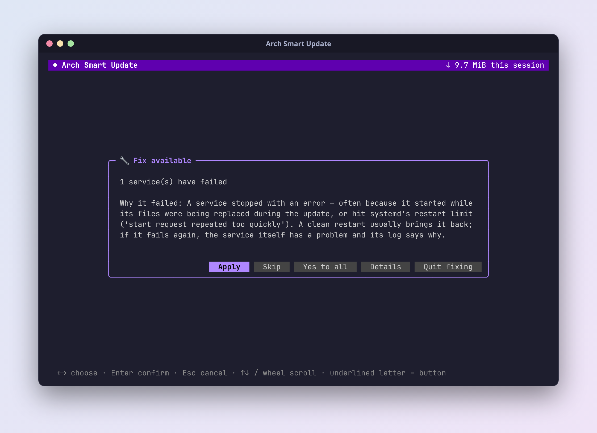
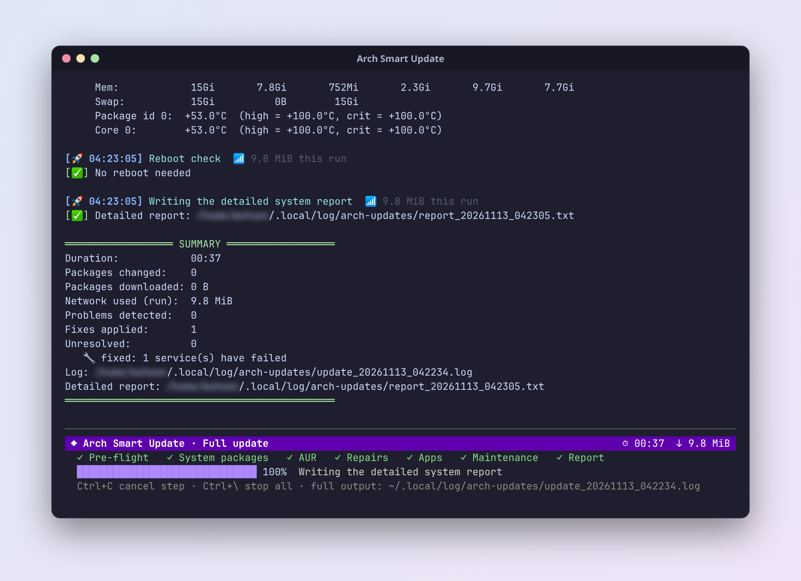
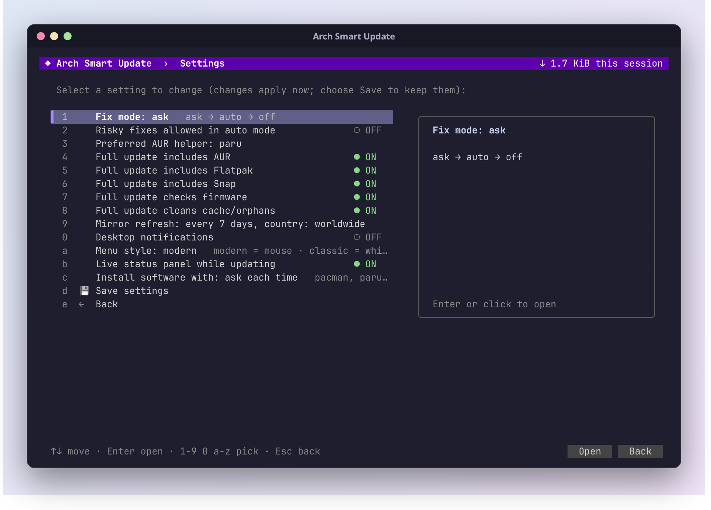

<div align="center">

# ◆ Arch Smart Update

**One command to update Arch Linux — and fix what goes wrong along the way.**

Official packages, AUR, Flatpak and Snap in the right order, a clean live view while it works,
and a plain-language explanation (plus a one-click fix) when something fails.

**[Website](https://mneftekhar.github.io/arch-smart-update/)** · [Install](#install) · [What it can fix](#what-it-can-fix)



</div>

---

## Contents

- [Why](#why)
- [Features](#features)
- [Screenshots](#screenshots)
- [Install](#install)
- [Usage](#usage)
- [What it can fix](#what-it-can-fix)
- [Configuration](#configuration)
- [Safety](#safety)
- [Requirements](#requirements)
- [License](#license)

---

## Why

Updating Arch is usually one command — until it isn't. A keyring is too old, a mirror is down, an AUR
package won't build, a file conflicts, the network drops halfway. Arch Smart Update runs the whole
update for you, and when a step fails it tells you **what happened, why, and what it will do about
it** — then does it, if you agree.

<sub>[↑ back to contents](#contents)</sub>

## Features

- **Everything in one run** — pre-flight checks and Arch news, official packages, AUR, rebuilds of AUR
  packages broken by library updates, Flatpak, Snap, firmware, cleanup and a health check.
- **A calm live view** — a fixed status panel at the bottom shows the phase, progress, time and data
  used, while the output scrolls above it. Long builds collapse into a single progress line.
- **Explains failures, then fixes them** — 60+ known problems are recognised; each comes with the
  likely cause, the exact commands of the fix, and an undo when there is one.
- **Mouse and keyboard menu** — every item has a hotkey (`1-9`, `0`, `a-z`), arrows work, clicks work.
- **Built for unreliable networks** — resumable downloads, DNS-over-HTTPS fallback, in-country mirrors,
  local proxy detection, and per-package rescue when only some files are blocked.
- **Safe by default** — nothing that changes your system runs without asking (unless you choose
  `--auto`), and stopping is refused while pacman is in the middle of installing.

<sub>[↑ back to contents](#contents)</sub>

## Screenshots



<sub>A full update, start to finish — sped up about 3×.</sub>

| Live update | A fix, explained before it runs |
|:---:|:---:|
|  |  |
| **Summary at the end** | **Settings** |
|  |  |

<sub>Personal details in the screenshots are blurred.</sub>

<sub>[↑ back to contents](#contents)</sub>

## Install

```bash
git clone https://github.com/mneftekhar/arch-smart-update.git
cd arch-smart-update
chmod +x smart-update.sh
./smart-update.sh
```

Optional: add it to your application menu with `./smart-update.sh --install-desktop`.

<sub>[↑ back to contents](#contents)</sub>

## Usage

| Command | What it does |
|---|---|
| `./smart-update.sh` | Opens the menu |
| `./smart-update.sh --run` | Full update straight away |
| `./smart-update.sh --dry-run` | Shows what would be updated, changes nothing |
| `./smart-update.sh --auto` | Applies safe fixes without asking |
| `./smart-update.sh --download-only` | Downloads now, install later (good on slow internet) |
| `./smart-update.sh --diagnose FILE` | Explains a saved pacman / paru / yay error log |
| `./smart-update.sh --help` | All options |

**Keys while it runs:** `Ctrl+C` skips the current step · `Ctrl+\` stops everything (postponed
until pacman has finished, so your system is never left half-updated).

<sub>[↑ back to contents](#contents)</sub>

## What it can fix

<details>
<summary><b>pacman and the system</b></summary>

Keyring and signature errors · locked database · broken or outdated mirrors · corrupted downloads ·
file and package conflicts · dependency blocks (including `IgnorePkg`) · removed repositories in
`pacman.conf` · unknown `pacman.conf` options · old database format · partial upgrades · a broken
pacman (via pacman-static) · stale pacman hooks · failed boot-image hooks · DKMS modules · low disk
space · wrong clock / TLS errors · locale warnings · failed services after the update.
</details>

<details>
<summary><b>AUR</b></summary>

Broken AUR helper after a pacman update · missing build tools · missing PGP keys · broken PKGBUILDs ·
unreachable source servers · out-of-memory builds · dependencies that no longer exist · packages that
need a rebuild after library updates · `~/.gnupg` permission problems · stuck gpg-agent.
</details>

<details>
<summary><b>Flatpak and Snap</b></summary>

Disabled or misconfigured Flatpak remotes and missing signing keys · the Flatpak system helper ·
Snap Store unreachable (finds a working route on filtered networks) · snapd not running ·
operations already in progress · snaps blocked by open apps · missing `/snap` link · squashfs
after a kernel update · AppArmor profiles · disk space.
</details>

<details>
<summary><b>Network</b></summary>

DNS failures (DNS-over-HTTPS fallback) · slow or unstable connections · mirrors that time out ·
packages blocked on many mirrors (fetched one by one over other routes, verified by pacman).
</details>

<details>
<summary><b>Leftovers</b></summary>

Broken symlinks — each is classified: leftovers of removed programs and services enabled before they
were renamed are moved to a backup; harmless ones (optional features, packaging quirks) are only listed.
</details>

<sub>[↑ back to contents](#contents)</sub>

## Configuration

Create a commented config file with `./smart-update.sh --config`
(`~/.config/arch-update.conf`). The most useful settings:

| Setting | Default | Meaning |
|---|---|---|
| `FIX_MODE` | `ask` | `ask` before each fix · `auto` apply safe fixes · `off` diagnose only |
| `AUR_HELPER` | `paru` | `paru`, `yay`, `pikaur`, `trizen` or `pamac` |
| `DO_AUR`, `DO_FLATPAK`, `DO_SNAP` | `true` | What a full update includes |
| `MIRROR_COUNTRY` | — | Countries for mirror ranking, e.g. `Germany,Netherlands` |
| `PROXY_URL` | — | Proxy for downloads that are blocked directly |
| `SNAP_KEEP_ROUTE` | `false` | Keep a working Snap Store route between runs |

Most of these can also be changed from **Settings** in the menu.

<sub>[↑ back to contents](#contents)</sub>

## Safety

- Every fix shows what it changes and the exact commands (`Details`) before it runs.
- Your files are moved to a backup folder, not deleted, and the restore command is printed. Only things
  pacman recreates by itself are removed: stale lock files, damaged downloads and package databases.
- Risky fixes (moving conflicting files, removing a blocking package) always ask first,
  even in `--auto` mode unless you also pass `--risky`.
- Every run is logged to `~/.local/log/arch-updates/`.

<sub>[↑ back to contents](#contents)</sub>

## Requirements

Arch Linux (or an Arch-based distribution) with `bash`, `sudo` and `curl`.
Optional: `paru` or `yay` for the AUR (it can install one for you), `flatpak`, `snapd`, `reflector`,
`aria2`, `zenity` / `kdialog` for desktop dialogs.

<sub>[↑ back to contents](#contents)</sub>

## License

[MIT](LICENSE) — free to use, change and share.

<sub>[↑ back to contents](#contents)</sub>
